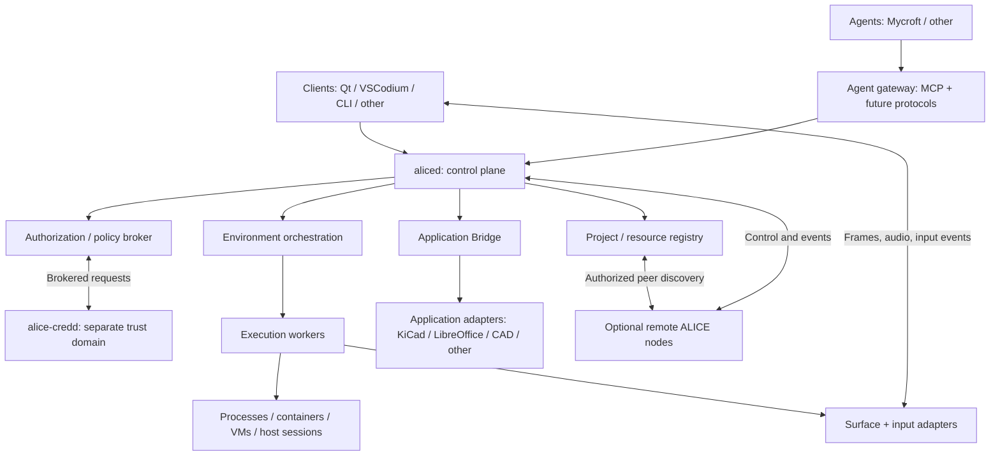

# ALICE System Architecture

**ALICE's Limited Interactive Computing Environment**  
*How deep does your rabbit hole go?*

| Field | Value |
| --- | --- |
| Document | `docs/ARCHITECTURE.md` |
| Status | **Draft 0.1: architectural baseline, not a frozen API** |
| Platform direction | Linux-first; C++20 core; independently implemented adapters |
| Companion documents | [Vision](VISION.md), [Design Principles](DESIGN-PRINCIPLES.md), [Security](SECURITY.md), [Roadmap](ROADMAP.md) |
| Licensing direction | AGPL-3.0-only core; independently licensed, permissive integration SDKs where appropriate |

> **ALICE standardizes interoperability, not implementation.** It provides secure defaults without artificial product ceilings. Administrators choose their boundaries; software enforces the boundaries actually chosen.

## 1. Purpose and scope

ALICE is a self-hostable platform for people and AI agents to observe and operate **project-scoped computing environments** through shared graphical, semantic, and programmatic interfaces. An IDE, browser, terminal, CAD tool, remote server, container, or complete operating system is a **resource operated by ALICE**, not a required part of ALICE itself.

This specification defines the architectural vocabulary, service responsibilities, trust and process boundaries, interoperability contracts, execution lifecycle, and initial delivery path. It deliberately does **not** freeze API wire formats, mandate one database or display protocol, select every implementation library, or assume a particular LLM. Those choices are recorded in ADRs as they mature.

### 1.1 Architectural commitments

1. **Standalone and federated:** a node works independently, without a vendor service or mandatory central controller; trusted nodes may cooperate.
2. **Native core, replaceable UI:** `aliced` and its workers can operate headlessly; VSCodium is an initial client option, Qt a planned native client, and neither owns the backend.
3. **Capability-oriented adapters:** callers request operations in ALICE's vocabulary; backends translate to their native protocols, with explicit feature negotiation.
4. **Separation of duties:** orchestration, policy, credentials, execution, document semantics, and display/input are distinct responsibilities.
5. **Secure by default, powerful by choice:** least privilege initially; entitled administrators may explicitly authorize privileged, host-integrated, or recursive environments.
6. **Shared human/agent control:** both can observe an environment; their identities, pointers, inputs, approvals, and audit trails stay distinguishable.
7. **Open ecosystem:** modular providers and documented protocols enable independently developed, including commercial, extensions.
8. **Observable and recoverable:** requested actions, policy decisions, backend actions, and outcomes can be correlated, diagnosed, and reconciled after failure.

### 1.2 Non-goals

ALICE is not an inference server, foundation model, editor, desktop environment, browser engine, hypervisor, custom PKI implementation, or universal CAD document format. It integrates these systems. ALICE does not guarantee that every application supports semantic control, that arbitrary GUI actions can be undone, or that host-root access can be safely contained on the same host.

## 2. Architectural vocabulary

The following are separate, first-class entities with stable identifiers. **Do not collapse them into one workspace object.**

| Entity | Definition | Ownership / lifetime |
| --- | --- | --- |
| **Node** | An independent ALICE installation exposing configured services and backend capabilities. | Operator-managed; online or offline. |
| **Project** | Desired resources, policies, identities, defaults, and working context. Not necessarily a source directory. | Configuration owned by an authorized principal or external orchestrator. |
| **Environment** | An instantiated execution context: process sandbox, container, VM, host-integrated process, remote attachment, or nested ALICE. | Runtime backend manages resources; ALICE manages requested lifecycle. |
| **Surface** | An observable and/or interactive presentation of a resource: desktop, window, browser tab, terminal, audio stream, etc. | Belongs to a runtime or adapter; detachable from any one viewer. |
| **Session** | An authorized attachment between a principal and one or more resources/surfaces. | Ephemeral, revocable, and separately authenticated. |
| **Principal** | A human, agent, service, or node with authenticated identity. | Identity provider issues/verifies identity; policy decides authority. |
| **Agent profile** | Markdown and structured declarations describing an agent's behavior and requested tools. | Descriptive metadata; never a security principal by itself. |
| **Task** | A tracked unit of agent or human-requested work, possibly spanning multiple tool calls and sessions. | Control-plane identity and history survive connection changes as configured. |
| **Resource** | A uniquely addressed object or service exposed to a project, such as files, Git, SSH, credentials, an app, or a surface. | Provider owns actual state and operations. |
| **Capability** | A typed action or observation a resource/provider declares it supports. | Provider advertises; trusted policy grants or denies use. |
| **Adapter** | An implementation translating ALICE operations to a native subsystem. | Separately deployed/versioned where practical. |
| **Grant** | Trusted authorization decision or delegated authority over a target and action. | Created by an entitled principal, never by editable agent instructions. |

A project may define **zero or many environments**. An environment may expose **zero or many surfaces**. Several human or agent sessions may attach to the same environment if policy allows. Environments and projects may outlive all viewers.

## 3. High-level system model



The diagram shows **logical interactions**, not permission equivalence. In particular, credential services and privileged runtime launchers have separate OS identities and are never reachable by an agent merely because they are in the same deployment.

### 3.1 Planes and their contracts

| Plane | Primary responsibility | Example traffic |
| --- | --- | --- |
| **Control** | Identity, project operations, policies, resource discovery, lifecycle, commands, approvals. | Request/response, status and errors. |
| **Event** | State changes, progress, user interaction, task events, audit references. | Subscriptions with sequence, correlation and timestamps. |
| **Media** | Frame/audio transport and time-sensitive human or agent input. | RDP, VNC/RFB, SPICE, WebRTC, Wayland-facing worker adapters. |
| **Application semantics** | Structured document, selection, objects, native commands, validation. | ALICE Application Bridge operations/events. |
| **Credential operations** | Secret-backed authentication, signing, request brokerage, rotation. | Restricted operations to `alice-credd` and providers. |

MCP is an **agent-facing protocol adapter**, not the sole ALICE internal API or the enforcement boundary. Likewise, video streaming is not forced through MCP or generic control RPCs.

## 4. Services and process boundaries

### 4.1 `aliced`: headless coordinator

The control-plane daemon shall:

- Accept authenticated local requests (initially protected Unix-domain sockets with peer identity verification) and, when enabled, authenticated remote requests.
- Resolve project and resource identities; discover advertised provider capabilities.
- Coordinate policy checks and trusted approvals before dispatching an operation.
- Start, attach, inspect, stop, and destroy environments through execution workers.
- Manage runtime session leases, subscriptions, task identifiers, and request correlation.
- Reconcile known resources with actual backend state following restart or worker disconnect.
- Serve equivalent functionality to CLI, Qt, VSCodium, agents, and future clients.

`aliced` **shall not** require a visible desktop, embed a general-purpose LLM, hold every credential, or run with blanket root privileges. Privileged operations belong to narrowly scoped helpers/workers. Its memory is not the single source of truth for external runtime resources.

### 4.2 `alice-ctl`: administrator/user command client

`alice-ctl` operates on the control plane using the caller's authenticated identity, with no special authority merely because it is a CLI. Proposed command families are `node`, `project`, `environment`, `session`, `resource`, `policy`, `agent`, `task`, `credential`, `plugin`, `diagnostics`. Syntax is provisional. CLI supports readable text and structured output suitable for scripts.

### 4.3 `alice-credd`: credential and authority service

A separately deployable trusted service provides policy-mediated credential **use**, lifecycle operations, and replaceable backends. Distinct contracts cover:

- `ISecretStore` (encrypted secret records and retrieval under policy),
- `IMetadataStore` (accounts, resource references, policy metadata and migrations),
- `IKeyProvider` (non-exportable where available: sign, wrap, unwrap and key generation),
- `IIdentityProvider` (authentication and external identity mapping),
- `IPolicyEngine` (decision and delegation),
- `ICertificateProvider` (import/issue/renew/rotate, including ACME or private PKI),
- `ICredentialProvider` (SSH agent, desktop secret service, remote vault, etc.).

The proposed **first ALICE-managed SQL adapter is PostgreSQL**; other SQL adapters can be installed. The core must not require PostgreSQL, SQLite, a TPM, or a proprietary vault in every deployment. A database stores ciphertext and metadata; it is **not** itself the encryption key store. Public TLS certificates, workload identity, authorization, and encryption at rest are separate mechanisms. Refer to [`SECURITY.md`](SECURITY.md) for the threat model and enforcement requirements.

### 4.4 Execution manager and workers

The manager uses providers for local processes, unprivileged containers, virtual machines, host-integrated sessions, and attached remote resources. Providers own the low-level lifecycle, resource cleanup, isolation features, and health reporting. A small privileged launcher may exist for operations that require it; general agents never inherit its authority.

Every backend advertises **effective** isolation, resource, device, filesystem, network, and nested-virtualization capabilities rather than merely identifying itself as a “sandbox.” An administrator can explicitly choose privileged host integration, with accurate disclosure that isolation may no longer be meaningful.

### 4.5 Agent gateway

Agent runtimes are external clients. ALICE exposes tools, resources, and event subscriptions through protocol adapters, beginning with MCP over supported transports. Tasks carry a stable identity across reconnects. Tool descriptions are generated from granted capabilities, not from the complete set of installed providers.

### 4.6 Application Bridge (AAB)

The Application Bridge is a distinct, transport-neutral service/interface with its own adapter registry and versioned capability descriptions. It interacts with a **running application's in-memory state** when the adapter can, not merely the last saved file. Details are in §9.

### 4.7 Clients and themes

Clients render project resources, sessions, surfaces, approvals, logs, and policies. They may also offer editors or terminals, but need not. Clients cannot grant themselves more authority by manipulating view state, and an agent's controlled surface does not include the host workbench chrome.

Themes, including a future LCARS theme, control presentation and interaction affordances, never authorization logic.

## 5. Protocol-neutral capabilities and adapter architecture

ALICE shall expose stable **intents** with typed parameters, results, errors, side-effect classifications, and declared capabilities. A provider translates a supported intent into native operations. This follows the same principle as one `play()` interface over many different sound modules: the abstraction covers common behavior without pretending all implementations are identical.

Example capability families (names provisional):

```text
surface.observe       surface.input.pointer   surface.input.keyboard
surface.attach        surface.resize          surface.audio
application.discover  document.get_active     document.revision
selection.get         object.read             object.update
command.execute       validation.run          events.subscribe
environment.create    environment.attach     environment.stop
credential.authorize  connection.open        session.revoke
```

Every provider shall expose a machine-readable **capability descriptor** with its supported operations, parameter schema, version range, limits, latency/streaming properties where relevant, and whether an operation is read-only, reversible, privileged, or destructive. Unsupported operations must return a distinct *unsupported capability* error, not silently imitate functionality.

**No lowest-common-denominator trap:** capability discovery and namespaced provider-specific extensions allow sophisticated CAD, audio, simulation, or network controls without forcing them into generic mouse clicks. No speculative universal PCB/3D/document object schema is required.

### 5.1 Adapter transport independence

Adapters may be C++, C, Python, Rust, TypeScript, or external programs using a documented protocol. Out-of-process, least-privileged deployment is the default. Native libraries may be supported when their embedding host and operator explicitly accept the crash/security consequences. First-party SDKs should be published separately with commercially friendly licenses where feasible.

### 5.2 Shared request envelope

A future control RPC envelope should carry at least:

| Field | Purpose |
| --- | --- |
| `request_id`, `trace_id` | Retry, diagnostics, correlation. |
| `principal_id`, `session_id`, `task_id` | Authenticated origin and work context. |
| `project_id`, `environment_id`, `resource_id` | Unambiguous target. |
| `operation`, `schema_version`, `arguments` | Typed requested action. |
| `deadline`, `idempotency_key` (when applicable) | Timeouts and safe retry semantics. |
| `expected_revision` (when applicable) | Optimistic concurrency. |
| `authorization_context` | Trusted broker-generated decision reference, not client-asserted privilege. |

Transport credentials establish origin, but authorization is evaluated against effective current policy. Clients cannot choose their own trusted principal, grant, or approval fields. Errors distinguish authentication failure, denied authorization, unsupported capability, conflict, timeout, canceled, unknown outcome, and backend failure.

## 6. Federation and topology

A node can run wholly offline. Optional federation connects independent nodes without changing their ownership or obligating a global control service.

Federation needs: explicit peer enrollment, authenticated encrypted transport, node and service identity, capability discovery, scoped delegation, topology and reachability reporting, request provenance, event subscriptions, revocation, and loop detection. Discovery can use configured peers initially; automatic discovery is a provider, not a requirement.

A remote node is **not trusted merely because its certificate validates**. Each node applies its own policy to inbound operations, credential use, file transfer, and delegation. Multi-hop calls retain authenticated origin and an auditable delegation chain. Cycles, recursive forwarding, and repeated requests require hop/resource limits and replay controls.

The first implementation may be a single-node daemon; the protocol and resource IDs must leave room for federation without requiring it for local operations.

## 7. Identity, groups, mappings, and authority

ALICE distinguishes:

- **Authentication:** Who is calling? (Unix peer credentials, local users, external directories, cert-backed services, etc.)
- **Mapping:** How do an OS user, group, external identity, ALICE principal, agent, and project membership relate?
- **Authorization:** What can that identity do to this resource, in this session, now?
- **Delegation:** Who may grant which additional authority, to whom, for how long?

Providers may integrate Unix users/groups, PAM/SSSD, identity directories, and external authentication services. The exact local user/group/password model is **intentionally open** and should not be smuggled into the project-file format. The policy engine must compute effective permissions using trusted identity sources; agent-edited Markdown and workspace manifests may request but cannot grant authority.

A client can request administrator approval, but the approval interaction must occur in a trusted channel outside the agent-controlled surface. Policies may explicitly enable unrestricted host execution for an entitled operator. Once an agent has effective host root, ALICE shall report that host-enforced containment guarantees no longer hold.

## 8. Project and environment lifecycle

The **project definition** is declarative desired state. An **environment** is an actual execution resource. A **session** is a revocable attachment. They follow independent lifecycles.

### 8.1 Suggested state machines

```text
Project:      defined -> enabled -> archived
Environment: absent -> provisioning -> ready -> running -> stopping -> stopped
                                      |            |
                                      +-> failed <-+
Environment: stopped/failed -> deleting -> absent
Session:     requested -> authorized -> active -> detached / revoked / expired
Task:        queued -> running -> waiting_approval -> running -> completed
                           |              |
                           +-> canceling -> canceled / failed
```

These are conceptual state groups, not finalized enums. All state transitions require an explicit command or provider event, have an observable outcome, and produce a correlation ID. Commands such as `stop` and `destroy` must not be conflated. Session disconnect must **not implicitly delete** a persistent environment. A task's cancellation request is not proof that its effects were rolled back.

### 8.2 Persistence ownership

| State | Primary owner | Recovery responsibility |
| --- | --- | --- |
| Project definition, workspace reopen preferences | Client or external orchestrator / configured project store | Chooses what to load or restart. |
| Environment runtime, VM/container metadata | Underlying backend + ALICE resource journal | Discover, reconcile, attach, clean up. |
| Application document and unsaved buffer | Application | Application's own save and recovery semantics. |
| Filesystems and snapshots | Storage/VM provider | Provider-specific backup, snapshot, restore. |
| Session lease, task progress | Control plane/event provider | Resume where supported or mark interrupted. |
| Credential state | `alice-credd` and selected providers | Independent backup, rotation, recovery. |
| Agent profile and instructions | Project/user-owned files | Load as untrusted configuration content. |

`aliced` does not decide that every project should auto-reopen after restart. A Qt client, another controller, or startup policy may request it. Nevertheless, `aliced` must reconcile surviving backends and resource ownership, so a daemon restart does not orphan live VMs or accidentally grant access to stale sessions.

### 8.3 Snapshot policy

Snapshots are an **optional backend/client capability**, not a universal promise. ALICE reports what is being snapshotted (filesystem, VM, memory, application document, etc.) and its consistency limitations. Native application save/undo and VM snapshots remain distinct operations.

## 9. Application Bridge and live document semantics

Applications may participate through visual interaction alone or provide structured access through an adapter:

1. **Visual:** frame capture, pointer and keyboard input, window context.
2. **Document aware:** active document, live selection, object identity, property inspection, dirty/revision state.
3. **Native actions:** object creation/mutation, commands, validations, available undo/transaction operations and change events.

Examples include LibreOffice through UNO, KiCad through supported application APIs, CAD software through its SDK/scripting interfaces, and proprietary applications through their documented automation interfaces where available. Provider support is version-dependent and must be discovered at runtime.

### 9.1 Required semantic safeguards

- **Stable references:** document and object handles must identify the instance/revision they refer to; don't mistake on-disk paths for live document identity.
- **Revisions and conflicts:** writes may require `expected_revision`; changed state returns conflict or requires re-evaluation.
- **Transaction truthfulness:** advertise atomicity, undo, rollback, and cancellation only when the application genuinely provides them.
- **Observability:** structured command results, validation messages, object changes, and corresponding visual updates should be correlatable.
- **Least-privileged scope:** permission to view a drawing does not automatically authorize editing every document or executing arbitrary application scripts.
- **Native escape hatches:** application-specific schemas and operations remain available through namespaced capabilities.

An adapter that can only read saved files shall report that limitation explicitly. An adapter that reads unsaved in-memory documents may be more authoritative for the current editing session, but cannot silently overwrite uncommitted human changes.

## 10. Interactive surfaces, streaming, and shared input

ALICE's **Surface API** abstracts observation and interaction from transport. It shall describe coordinate systems, pixel geometry, DPI/scale, frame and audio capabilities, input types, focus, clipboard policy, latency hints, and ownership of actual input events.

### 10.1 Transport strategy

Start with an established, maintained remote-display protocol behind a reusable adapter (for example, RFB/VNC for a straightforward initial desktop proof, or RDP/SPICE when their capabilities and available implementations better fit). Media adapters may later use WebRTC or specialized low-latency protocols. This initial selection belongs in an ADR after measurement. The abstraction must **not** force all providers to use a single stream, codec, platform, or mouse model.

Local compositor control, browser DOM automation, remote desktop virtual input, and in-guest virtual devices can share high-level intents while preserving their native features. An RFB server that exposes only one actual cursor does not magically provide two independent application cursors.

### 10.2 Two logical cursors, one controlled application

ALICE shall track **human and agent pointers independently**, rendering distinguishable overlays when supported. The input broker maps authorized input into the actual target surface and labels events with their origin.

- A human click generates a **trusted human-interaction event** for subscribed agent sessions and is delivered to the controlled application when permitted.
- Independent visual cursors do not imply concurrent control of the underlying application's focus. Pointer and keyboard arbitration is explicit.
- Human takeover/interrupt is immediately visible and can pause future agent input. Critical native/API operations may have safe cancellation points rather than arbitrary termination.
- During agent-declared or policy-identified critical operations, the client may dim the interaction surface and show an overlay explaining how to interrupt or take control. **Dimming is UX, not authorization.**
- A trusted, out-of-band stop/revoke path remains available even if the rendered surface or agent is unresponsive.
- Exclusive interaction leases may be used for operations that cannot tolerate conflicting GUI input. Leases are scoped and time-bound, never silently permanent.

### 10.3 Input arbitration sketch

```text
human pointer ------> UI input broker ------> authorized input adapter ------> application
agent pointer ------> UI input broker ------> authorized input adapter ------> application
                           |                        |
                           +--> interaction events  +--> actual state/results
                           +--> policy + leases
```

Human activity is **not automatically equivalent to a request to abort a transaction**. The client should distinguish observing, clicking, requesting takeover, and emergency revocation. Agent awareness and coordination are desirable; guarantees against conflicts depend on the application's own capabilities.

### 10.4 Performance requirements

Keep real-time frame transport and pointer feedback off high-latency generic control request paths. Measure input-to-photon latency, frame pacing, encoding cost, jitter, backpressure, and reconnect behavior. Gaming-class interactive performance is a possible high-performance profile, not a promise for the first release. Applications and game services may impose their own automation rules.

## 11. Agent profiles, tasks, and model independence

Agent profiles can be Markdown documents, for example:

```text
.alice/
  project.yaml
  agents/
    mycroft/
      identity.md
      instructions.md
      requested-capabilities.yaml
```

Markdown defines persona, domain guidance, and workflow conventions. YAML (or another chosen schema) may declare requested capabilities. **Neither is an authorization grant.** Actual permissions live in trusted policy state and are resolved per principal/session/task.

ALICE shall distinguish the **model** (inference provider), **agent runtime** (planner/tool caller), **agent profile** (behavioral configuration), **principal** (authenticated identity), and **task** (tracked work). Multiple profiles can use one model, and an agent can reconnect or switch model providers without changing a project's security identity.

Tasks expose status, progress, result references, cancellation, approval requests, and event subscriptions. Context compaction and model memory management remain agent responsibilities; ALICE provides resources, observations, and durable task references as configured.

## 12. Plugins, providers, and packaging

Adapters and extensions declare: identity, publisher, version, compatible core/API range, provided capabilities, requested privileges, process model, configuration schema, dependencies, health endpoints, and license information.

**Default:** run third-party adapters as separate, restricted processes. Native in-process libraries are optional and require conscious trust/compatibility decisions. A signed package or manifest may establish provenance, but does not itself establish authorization or safety. Package distribution need not depend on an ALICE-operated central marketplace.

The core should not assume an extension is open-source merely because it works with ALICE. Paid and proprietary independent integrations are welcome under applicable licenses. Keep protocol definitions and SDKs separable from the AGPL core, with their own reviewed licensing choices.

## 13. Observability, diagnostics, and audit

ALICE adopts structured, correlation-friendly events from the beginning, with log and audit records clearly separated. `alice-ctl` and daemons should support `-v` through `-vvvvv` (or equivalent configured levels):

| Level | Additional diagnostic detail |
| --- | --- |
| default | Warnings, errors and essential lifecycle outcomes. |
| `-v` | Routine operations and service changes. |
| `-vv` | Component and provider state transitions. |
| `-vvv` | Request/response metadata and event correlation. |
| `-vvvv` | Policy decision metadata, retries, negotiation and routing. |
| `-vvvvv` | Maximum **safe** trace detail, redacted structured payloads and timing diagnostics. |

Every operation should be traceable as **request -> authenticated origin -> policy decision -> dispatch -> backend observation -> outcome**. Include resource IDs, node IDs, timestamps, error codes, and latency. The audit store's retention, export, integrity protections, and access control are separately configurable.

Even at `-vvvvv`, do not intentionally log bearer tokens, passwords, raw key material, session cookies, or secrets. If capturing sensitive protocol payloads is absolutely necessary for debugging, use a separately authorized, time-limited diagnostic workflow rather than weakening routine logging globally.

Health/readiness checks, metrics, reproducible issue bundles, fault injection, and contract tests are part of the engineering plan, not late add-ons.

## 14. Compatibility and change management

The project is **pre-1.0**. We will not prematurely freeze protocols, but we will design them to be versionable:

- Every publicly exchanged capability and message has an explicit schema/version or negotiable compatibility range.
- Providers negotiate capabilities rather than relying solely on product version numbers.
- Unknown optional fields can be ignored safely; unknown required semantics are rejected clearly.
- Breaking changes are documented, with migration guidance and contract tests.
- Resource identifiers and durable state schemas evolve through explicit migrations.
- Local and federated nodes may run different compatible versions without granting new authority accidentally.

A baseline minimal interoperable surface for the first prototype should include authenticated discovery, environment lifecycle, surface attachment, pointer/keyboard input, frame observation, session revoke, typed errors, and trace correlation. **The exact minimum versions, serialization, and transports are ADR decisions after working implementations.**

## 15. Failure, recovery, and cleanup contracts

ALICE must distinguish:

| Condition | Expected response |
| --- | --- |
| UI client disconnects | Detach its session; do not destroy a persistent environment by default. |
| Agent disconnects | Revoke or expire tool leases per policy; retain/reconcile task outcome and application state. |
| `aliced` restarts | Re-discover resources, reconcile leases, validate authority afresh; do not blindly replay non-idempotent actions. |
| Worker crashes | Mark capabilities degraded, record failure, clean/restart only per backend policy. |
| Credential service unavailable | Fail closed for operations requiring fresh credential authorization; preserve safe unaffected operation. |
| Network partition between nodes | Reject unsafe unknown-authority operations; surface partition and potential unknown outcomes. |
| Cancellation during critical work | Stop issuing new actions; report completed/unknown side effects; use rollback only if actually supported. |
| Environment deletion | Revoke scoped sessions and leases, release mounts/sockets, and clean up backend resources; preserve external resources unless explicitly targeted. |

Idempotent retries require operation-specific semantics. A timeout after submitting a command must be allowed to produce an **unknown outcome**, rather than automatically re-executing a potentially destructive command.

## 16. Example flows

### 16.1 Human opens an isolated graphical application

1. Client loads a project definition and asks `aliced` for authorized resources.
2. `aliced` obtains the effective permissions and capabilities from trusted providers.
3. Client requests an environment; the execution manager provisions it with declared isolation.
4. A surface provider advertises a display attachment endpoint.
5. Client establishes an authenticated media/input session, renders the surface, and remains able to detach without destroying it.

### 16.2 Agent modifies a PCB through the Application Bridge

1. Agent gateway identifies the principal, task, project, and authorized KiCad adapter.
2. Agent reads the active document and current selection, including revision identifiers.
3. Agent proposes a native object operation with expected revision and declared side effects.
4. Broker checks scope and any required approval; adapter executes only if capability/policy and revision allow.
5. Adapter returns result, affected objects, validation status, and applicable undo metadata. The surface visually updates; both human and agent receive correlated events.

### 16.3 A human interrupts critical agent input

1. Agent acquires a time-limited interaction lease and client shows a clearly labeled critical-operation overlay.
2. Human moves their distinct pointer and clicks or activates a dedicated takeover control.
3. The trusted input broker emits human activity/takeover events and halts or arbitrates subsequent agent input.
4. In-flight native actions are canceled **only** if their backend supports safe cancellation. Otherwise ALICE shows progress and allows revocation of future actions.

### 16.4 Nested ALICE

1. Administrator grants an environment the resources needed to run a child ALICE installation, possibly including nested virtualization or host integration.
2. Child starts with the capabilities actually available through its environment; it does not obtain parent policy-control access merely by running ALICE.
3. Additional powers may be granted explicitly by an independently entitled administrator, even up to host-level authority.
4. ALICE represents the resulting effective security posture truthfully. Resource and recursion limits follow real backend constraints, not arbitrary product depth limits.

## 17. Initial implementation strategy and acceptance gates

The first vertical slice should demonstrate the **core interaction contract**, not a complete IDE or universal provider catalog.

| Milestone | Scope | Acceptance evidence |
| --- | --- | --- |
| **M0: Headless foundation** | `aliced`, `alice-ctl`, local peer authentication, provider registry, typed errors, `-vvvvv`. | Create/inspect/remove a test resource; denied calls stay denied; trace is inspectable. |
| **M1: Isolated runtime** | One Linux execution backend, resource journal, environment start/stop/attach/reconcile. | Agent cannot access unauthorized host resources; daemon restart reconciles a surviving environment. |
| **M2: Shared graphical surface** | One established display protocol, observation, virtual input, logical dual cursors, human event notifications. | Human and agent can operate the same test application without controlling host workbench chrome. |
| **M3: Agent gateway** | MCP adapter, agent/task identity, capability filtering, tool cancellation and authorization. | Mycroft or another agent can operate only its granted test environment. |
| **M4: Application semantics** | One document-aware adapter, revision check, native operation, correlated visual result. | Agent can inspect and modify a live test document, detect conflict, and report truthful undo support. |
| **M5: Remote node prototype** | Enrolled second node, authenticated transport, capability discovery and scoped delegation. | Remote operation works, revocation works, and partitions don't silently grant new access. |

Security gates apply to **every** milestone; `SECURITY.md` defines initial minimum acceptance tests. Demonstrations must show actual enforcement, not merely a disabled UI action or prompt instruction.

## 18. Open decisions and candidate ADRs

These choices are *not* silently settled by this document:

| Topic | Current position | Proposed decision record |
| --- | --- | --- |
| Initial media protocol | Start with a mature stream protocol behind the Surface API; benchmark VNC/RFB, RDP, SPICE for first slice. | ADR-0003 |
| Control/event wire format | Versioned and protocol-neutral; exact serialization/transport TBD. | ADR-0004 |
| Identity users/groups/passwords | Pluggable authentication and mappings; policy remains separate. | ADR-0005 |
| Backend isolation | Linux-first, unprivileged default; select container/process/VM prototype. | ADR-0006 |
| Persistent resource journal | Necessary for reconciliation; ownership and storage adapter TBD. | ADR-0007 |
| First Application Bridge adapter | KiCad and LibreOffice/FreeCAD are candidates; validate against installed APIs. | ADR-0008 |
| Credential federation and bootstrap | Standalone provider first; remote trust enrollment and recovery later. | ADR-0009 |
| API stability policy | Version negotiation from start, minimum frozen interfaces after working validation. | ADR-0010 |
| Initial frontend | VSCodium integration for rapid proof, native Qt client later; both optional. | ADR-0011 |

The following decisions **are adopted as architectural directions**:

- Federated, standalone-capable nodes without a mandatory central controller.
- Native, protocol-neutral internal capability interfaces with adapters for external protocols.
- Out-of-process extension providers by default; in-process integration optional by explicit trust decision.
- Distinct project/environment/session/resource/principal/task concepts.
- Secure defaults with authorized privilege elevation, including host integration and recursive ALICE.
- Human and agent have separate logical pointers with clear input origin and intervention controls.
- The daemon reconciles backend resources; clients/orchestrators choose workspace auto-restore policy.
- Rich diagnostic verbosity with deliberate secret protection.

## 19. Architecture review checklist

Before merging a new subsystem, its design review must answer:

1. **Who owns the authoritative state**, and who reconciles it after restart?
2. **What are its process and trust boundaries**, and which OS identity enforces them?
3. **Which capabilities does it advertise**, including unsupported operations and side effects?
4. **How is the caller authenticated and authorized**, including delegation and revocation?
5. **How does it fail**, report ambiguous outcomes, clean up, and recover?
6. **What can a human observe, interrupt, or approve**, without agent forgery?
7. **Which providers or transports can be replaced** without rewriting the control plane?
8. **How is it logged and tested**, without exposing secret material?
9. **What data can users export or migrate**, and what open-source dependencies are required?
10. **Does the component preserve administrator choice** without misrepresenting the resulting risk?

---

**ALICE's architectural rule:** *The host owns the machinery. The project declares the world. Providers implement capabilities. Policy governs authority. Humans and agents share the work, but not necessarily the same privileges.*

*The rabbit hole has no artificial depth limit; the laws of physics, operating systems, and explicit authority still apply.*
